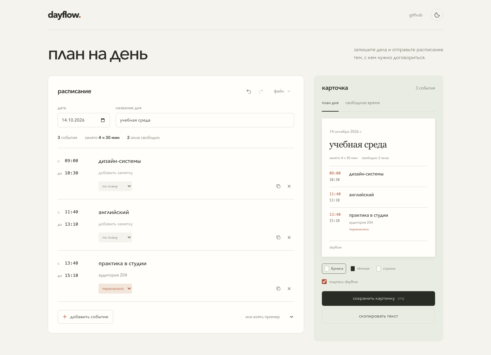
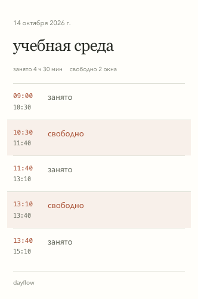
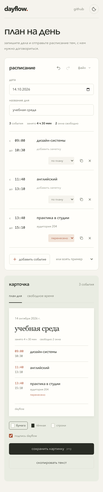

# dayflow

расписание на день, которым удобно поделиться. запишите дела, добавьте заметки и сохраните план картинкой или скопируйте текст для сообщения. если названия встреч лучше оставить при себе, покажите только занятое и свободное время.

[открыть dayflow](https://chebaturkin.github.io/dayflow/)



## что можно сделать

- собрать план с датой, названием дня, заметками и статусами событий;
- показать расписание целиком или скрыть названия и оставить свободное время;
- сохранить картинку в одном из трёх оформлений или скопировать текст для сообщения;
- добавить следующее событие сразу после последнего дела;
- отменить правку, удаление или замену расписания, затем повторить действие;
- скачать события для календаря в ics, сохранить расписание в json и открыть его позже;
- выключить подпись dayflow на карточке;
- работать со светлой или тёмной темой, с компьютера или телефона.

свободными считаются промежутки от 30 минут между событиями. пересекающиеся встречи подсвечиваются, а занятое время считается без повторов. отменённые события остаются в редакторе и не попадают в карточку.

<details>
<summary>карточка со свободным временем</summary>

названия событий и заметки не попадут ни в картинку, ни в скопированный текст.



</details>

<details>
<summary>тёмная тема</summary>


</details>

<details>
<summary>на телефоне</summary>



</details>

## как пользоваться

выберите дату и напишите название дня, если оно нужно. замените пример своими делами или начните с пустого листа. время вводится в формате `09:30`; можно набрать `0930`, двоеточие появится само.

справа выберите, чем поделиться: планом или свободным временем. затем сохраните картинку или скопируйте текст. меню «файл» открывает и сохраняет расписание, скачивает события для календаря и возвращает пример.

`ctrl / ⌘ + enter` добавляет событие. `ctrl / ⌘ + z` отменяет изменение, `ctrl / ⌘ + shift + z` повторяет его. внутри текстового поля работает привычная отмена ввода; для отмены всего действия есть кнопки рядом с меню «файл».

## где хранятся данные

регистрация и доступ к календарю не нужны. расписание сохраняется в браузере на этом устройстве и не отправляется на сервер. для переноса на другой компьютер скачайте json через меню «файл».

если очистить данные браузера, локальное расписание пропадёт. перед очисткой сохраните копию. в примерах стоят вымышленные события.

## запуск

нужен node.js 20 или новее.

```bash
npm install
npm run dev
```

откройте адрес из терминала.

## проверка

```bash
npm test
npm run build
```

модульные тесты проверяют расчёты, пересечения, историю изменений, текстовый экспорт, импорт json и экспорт ics. сборка включает проверку типов и создаёт статический сайт в `dist/`.

для браузерных проверок нужен python с playwright и установленным chromium. запустите сайт через `npm run dev`, затем в другом терминале:

```bash
python3 tests/browser-check.py
python3 tests/layout-check.py
```

первая проверка проходит основные действия пользователя и обновляет скриншоты. вторая проверяет раскладку на девяти ширинах от 320 до 1440 пикселей. переменная `DAYFLOW_URL` позволяет проверить другой адрес.

## публикация

изменения в `main` автоматически собираются и публикуются через github actions на [github pages](https://chebaturkin.github.io/dayflow/).

## лицензия

[mit](LICENSE)
