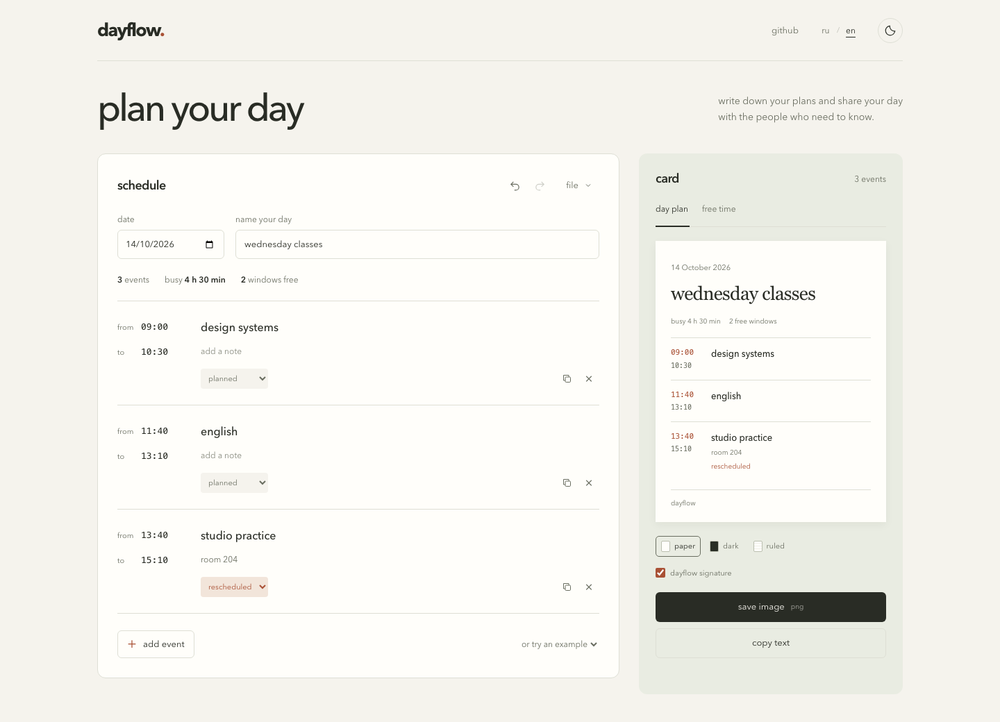
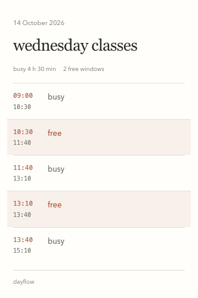
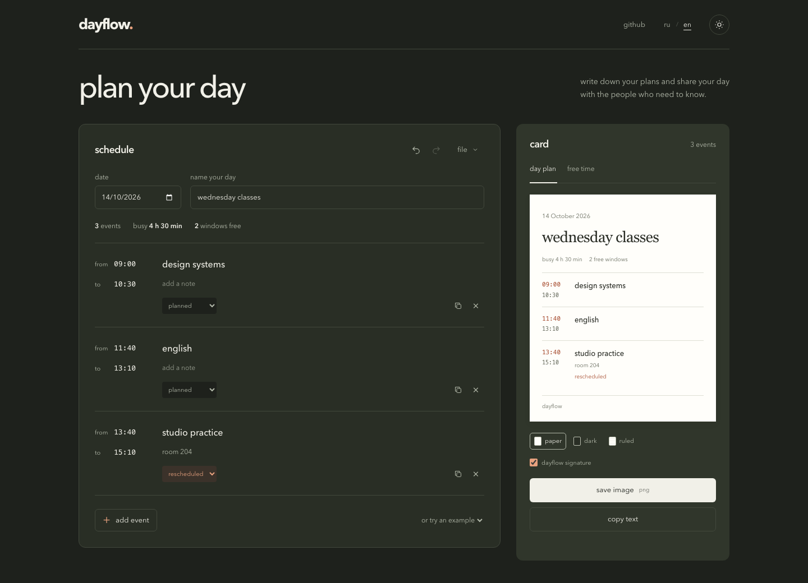
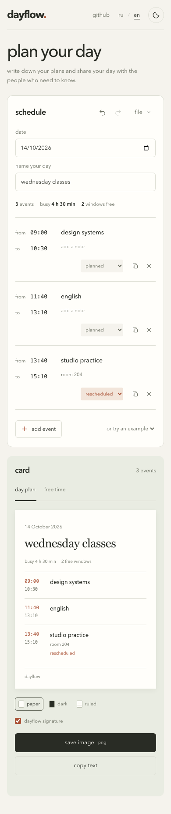

**english** · [русский](README.ru.md)

# dayflow

a day plan you can share as an image or text. add events and notes, or share only your busy and free time when meeting names should stay private.

[open dayflow](https://chebaturkin.github.io/dayflow/?lang=en)



## what you can do

- give the day a date and a name, and add notes and event statuses;
- share the whole plan or show only your availability;
- save an image in one of three styles, or copy text for a message;
- add an event after the last one in your schedule;
- undo and redo edits, deletions and schedule replacements;
- download an ics calendar file, save a json copy and open it later;
- hide the dayflow signature on the card;
- use the light or dark theme on a computer or phone.

free windows are gaps of at least 30 minutes between events. overlapping events are marked, and busy time counts each minute once. cancelled events remain in the editor and stay off the shared card.

<details>
<summary>a card showing free time</summary>

event names and notes stay out of both the image and copied text.



</details>

<details>
<summary>dark theme</summary>



</details>

<details>
<summary>on a phone</summary>



</details>

## using it

choose a date and name your day if you want to. replace the example with your own events or start fresh. enter times as `09:30`; typing `0930` adds the colon for you.

choose a day plan or free time on the right, then save an image or copy the text. the file menu opens and saves schedules, downloads calendar events and restores the example.

`ctrl / ⌘ + enter` adds an event. `ctrl / ⌘ + z` undoes a change; `ctrl / ⌘ + shift + z` redoes it. inside a text field, the usual text undo still works. use the buttons beside the file menu to undo a whole action.

## language

the interface, fresh examples and exported labels support english and russian. choose `ru / en` in the header. a valid `?lang=en` or `?lang=ru` link takes priority, then your saved choice, the first supported browser language and english as the fallback.

switching happens in place. your own names, notes, dates and unfinished time edits stay as entered. existing saved records are never automatically translated.

## your data

no registration or calendar access is needed. the schedule stays in this browser on this device and is not sent to a server. save a json copy through the file menu to move it to another computer.

clearing browser data removes the local schedule, so download a copy first. built-in examples contain fictional events.

## run locally

use node.js 20 or newer. install the versions recorded in the lockfile:

```bash
npm ci
npm run dev
```

open [the local app](http://127.0.0.1:4321/dayflow/?lang=en). the terminal shows a different address if port 4321 is busy.

## checks

```bash
npm test
npm run build
```

tests cover calculations, overlapping events, undo history, text sharing, json import, ics export and language selection. the build checks types and creates a static site in `dist/`.

browser checks need python, playwright and its chromium. start the site, then run:

```bash
DAYFLOW_URL=http://127.0.0.1:4321/dayflow/?lang=ru python3 tests/browser-check.py
python3 tests/layout-check.py
python3 tests/language-check.py
```

`DAYFLOW_URL` can point to another local server. language checks cover pending edits, user text, URL parameters, preference persistence, exports and both languages at 320, 390, 768 and 1440 pixels. layout checks also cover five intermediate widths.

the screenshots above use fictional events and the corresponding interface language. to refresh both sets from the running app:

```bash
python3 tests/capture-languages.py
```

## publishing

changes in `main` are built and published through github actions to [github pages](https://chebaturkin.github.io/dayflow/?lang=en).

## license

[mit](LICENSE)
